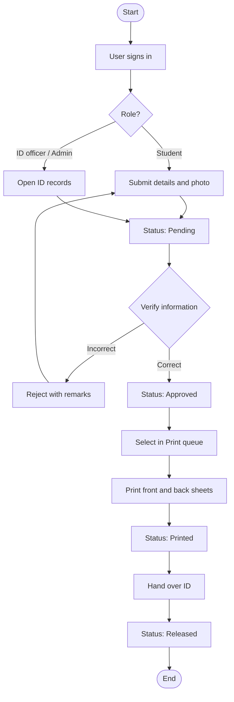
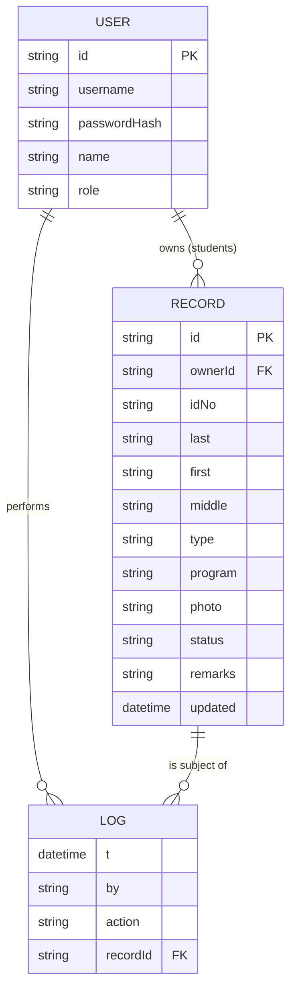

# University ID Maker System: Technical and User Documentation

**Institution:** Central Philippines State University, San Carlos Campus
**College:** College of Computer Studies
**Course:** Web Systems and Technology (PFIT 03), A.Y. 2026 - 2027
**Proponents:** Lyra Michelle S. Judiana (Project Manager), Mayome L. Panunciar (System Analyst), Leah V. Libongcogon (System Developer), Angeline V. Piala (Project Documentation)
**Submitted to:** Feleciano L. Santiago Jr., MSIT, Course Instructor

---

## 1. Overview

The University ID Maker System replaces the manual collection of personal information and hand-prepared identification cards with a single digital workflow. Applicants submit their details and photo, authorized personnel verify and approve them, and the system produces standardized, print-ready ID cards. Every step is recorded so that ID transactions can be monitored and reviewed later.

## 2. Alignment with the Proposal

| Proposal objective | Where it is implemented |
| --- | --- |
| 1. Digital data-entry module (name, ID number, department, profile picture) | ID record form (`RecordForm.vue`), photo is cropped to 3:4 and compressed in the browser |
| 2. Automated ID generation from standardized templates | `IdCard.vue` renders the front and back from one fixed template, with live preview |
| 3. Centralized database with search, retrieval, and update | ID records page (`Records.vue`), search by name, ID number, or course; filter by status |
| 4. Print-ready cards with consistent layout | Print queue (`Print.vue`), CR80 size (54 x 85.6 mm), 9 per A4 sheet, fronts then mirrored backs |
| 5. Authentication and access control | Sign-in, role-based route guards in `main.js`, role checks in each view |
| 6. Status monitoring and reporting | Dashboard counts per status and course, transaction log, status tracker for applicants |

Problem-statement questions 2 and 3 (submitting information and tracking status) are covered by the student **My ID application** page.

## 3. Users and Permissions

| Capability | Administrator | ID officer (authorized personnel) | Student / applicant |
| --- | :---: | :---: | :---: |
| Sign in | Yes | Yes | Yes |
| Submit and track own application | No | No | Yes |
| View dashboard and transaction log | Yes | Yes | No |
| Create, edit, search ID records | Yes | Yes | Own record only, until approval |
| Verify, approve, or reject records | Yes | Yes | No |
| Print ID cards and mark as printed or released | Yes | Yes | No |
| Delete records | Yes | No | No |

Demo accounts are listed in the README.

## 4. ID Application Workflow



## 5. Data Model



Only data needed for ID production is stored, in line with the proposal's scope. Statuses are `Pending`, `Approved`, `Printed`, `Released`, and `Rejected`. ID numbers must be unique and may contain letters, numbers, and hyphens.

## 6. System Architecture

- **Framework:** Vue 3 (Composition API, `<script setup>`), Vue Router 4 (hash mode), Vite 5.
- **State:** a single reactive store (`src/store.js`) persisted to the browser's `localStorage`. The signed-in session lives in `sessionStorage` and ends when the tab closes.
- **Card rendering:** CSS container query units make one card component scale from on-screen preview to exact physical size when printed. The back of the card carries a Code 39 barcode of the ID number, generated as SVG.

```
src/
  main.js            router and access-control guard
  store.js           data, authentication, record actions, transaction log
  App.vue            application shell and role-based navigation
  styles.css         design tokens and shared styles
  components/IdCard.vue
  views/             Login, Dashboard, Records, RecordForm, Print
```

## 7. Installation

Requirements: Node.js 18 or newer.

```bash
npm install
npm run dev       # development server
npm run build     # production files in dist/
```

## 8. User Guide

**Students**
1. Sign in and open **My ID application**.
2. Enter your name, ID number, and course, then upload a clear, front-facing photo.
3. Select **Submit application**. Follow progress on the status tracker. If the application is returned, read the remarks, correct the details, and resubmit.

**ID officers and administrators**
1. Open **ID records** to search, add, or edit records. Use **Preview** to inspect the front and back of a card.
2. For each Pending record, choose **Verify and approve** or **Reject** (a reason is required).
3. Open **Print queue**, tick the approved IDs, and select **Print**. Use A4 paper, scale 100%, and duplex on the long edge. Confirm the prompt to mark the IDs as Printed.
4. After handover, select **Mark released** on the record.
5. Use the **Dashboard** to monitor totals per status and course, and to review recent transactions.

## 9. Testing Checklist

| # | Test | Expected result |
| --- | --- | --- |
| 1 | Sign in with a wrong password | Error message, no access |
| 2 | Open `#/records` while signed out | Redirected to sign-in |
| 3 | Student opens `#/records` | Redirected to My ID application |
| 4 | Add a record with a duplicate ID number | Save is blocked with a message |
| 5 | Approve a Pending record | Status changes and a log entry appears on the dashboard |
| 6 | Reject a record with remarks | Student sees the remarks and can resubmit |
| 7 | Print two approved IDs | Print preview shows a front page and a mirrored back page |
| 8 | Staff tries to delete a record | Delete button is not available |

## 10. Scope, Limitations, and Future Work

In line with the proposal, the system does not manufacture or deliver physical cards and offers only the standardized template rather than advanced graphic design.

Current limitations of this prototype:
- Data is stored in each browser, so records are not shared between computers.
- Passwords are hashed with a lightweight function suited to a demo, not production security.
- Reports are limited to dashboard summaries and the transaction log.

Recommended next steps: a server API with a database (for example Node.js with MySQL), proper password hashing and session tokens, user management for administrators, selectable card templates, exportable reports (PDF and CSV), and bulk import of student records.
